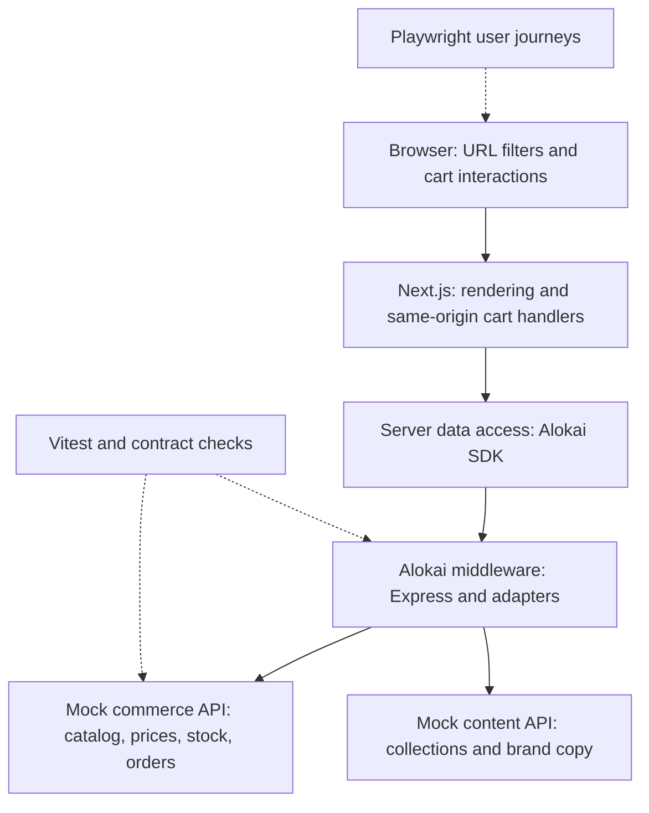

# Architecture

## Topology

This is the target architecture, not a deployed system.

The two provider APIs initially share `apps/mock-services`, one process and separate modules. They model external boundaries without creating a microservice fleet. Providers are deterministic fixtures, not connections to real enterprise systems.

## Repository boundaries

| Area | Owns | Must not own |
| --- | --- | --- |
| `apps/storefront` | Pages, accessibility, URL filters, cart interactions, server-side SDK client | Authoritative prices, provider credentials, Express/Alokai server modules in client bundles |
| `apps/middleware` | Alokai configuration, provider clients, normalization, request correlation, timeout/error mapping | UI state, catalog authoring, duplicate stock/order storage |
| `apps/mock-services` | Fictional catalog/content, inventory and atomic order acceptance, in-memory idempotency records | UI components or knowledge of Next.js |
| `packages/contracts` | Provider-independent API schemas, DTOs and examples | Runtime application state or React/Express imports |

Use npm workspaces; no Turborepo until orchestration cost justifies it. Within apps, organize by feature. Extract small pure pricing/validation functions in the module that owns them; add another package only if there is an actual second consumer. Prefer composition over introducing a generic repository/service/controller hierarchy everywhere.

## Request and trust boundaries

- Product pages are Server Components. The server-only data layer uses the SDK to call Alokai middleware. Keep provider-specific types behind adapters.
- Cart writes use small same-origin Next Route Handlers that delegate to the SDK. They are transport/session boundaries, not another commerce implementation.
- The browser stores no authoritative price. Order input contains product IDs and quantities. Reject unexpected price/total fields and recalculate inside the commerce provider.
- Use an opaque guest session cookie (`HttpOnly`, `SameSite=Lax`, `Secure` on HTTPS). Validate origin for mutations and enforce session ownership server-side. Do not accept a client-provided cart owner.
- Keep catalog cache policy explicit. Never share-cache carts/orders or cookie-dependent responses; check stock during order acceptance even when catalog data was cached.
- For a process-local mock, stock check, decrement, order creation and idempotency record must be one synchronous critical section with no `await` inside. A multi-process production service would require a database transaction/conditional update. State resets on restart; disclose this demo limitation.
- Use integer cents and an ISO currency code. Reject negative/zero/fractional quantities and duplicate IDs in input. Bound request size and item counts.
- Configure provider addresses from trusted server configuration; never proxy an arbitrary client-supplied URL.

## Error model

Normalize domain and upstream errors into a stable `{ code, message, requestId, details? }` envelope. Never return stack traces or raw upstream bodies. Preserve business errors separately from infrastructure failures.

| Condition | Public status | Code |
| --- | --- | --- |
| Invalid input | 400 | `INVALID_INPUT` |
| Unknown product | 404 | `PRODUCT_NOT_FOUND` |
| Insufficient stock | 409 | `OUT_OF_STOCK` |
| Reused idempotency key with different body | 409 | `IDEMPOTENCY_CONFLICT` |
| Provider unavailable | 502 | `UPSTREAM_UNAVAILABLE` |
| Provider timeout | 504 | `UPSTREAM_TIMEOUT` |

Alokai's actual transport may wrap statuses differently. Verify mapping in M1 rather than assuming an SDK method is a REST GET endpoint. The OpenAPI file specifies the demo provider contract, not the generated Alokai wire protocol.

## Deployment and operation

Local target ports: storefront 3000, middleware 4000, mock providers 4100. These are proposed values. Add `.env.example` when real configuration exists. Bind mock admin/failure injection to test mode only. Log request ID, operation, duration and outcome, without cookies, tokens or customer data.

First implementation uses local processes. Add containers only after the same commands work without Docker. Production deployment, persistence, authentication provider and payments are separate decisions.

See [decisions](adr/0001-boundaries-and-scope.md), [the stack](STACK.md) and [quality](QUALITY.md).
