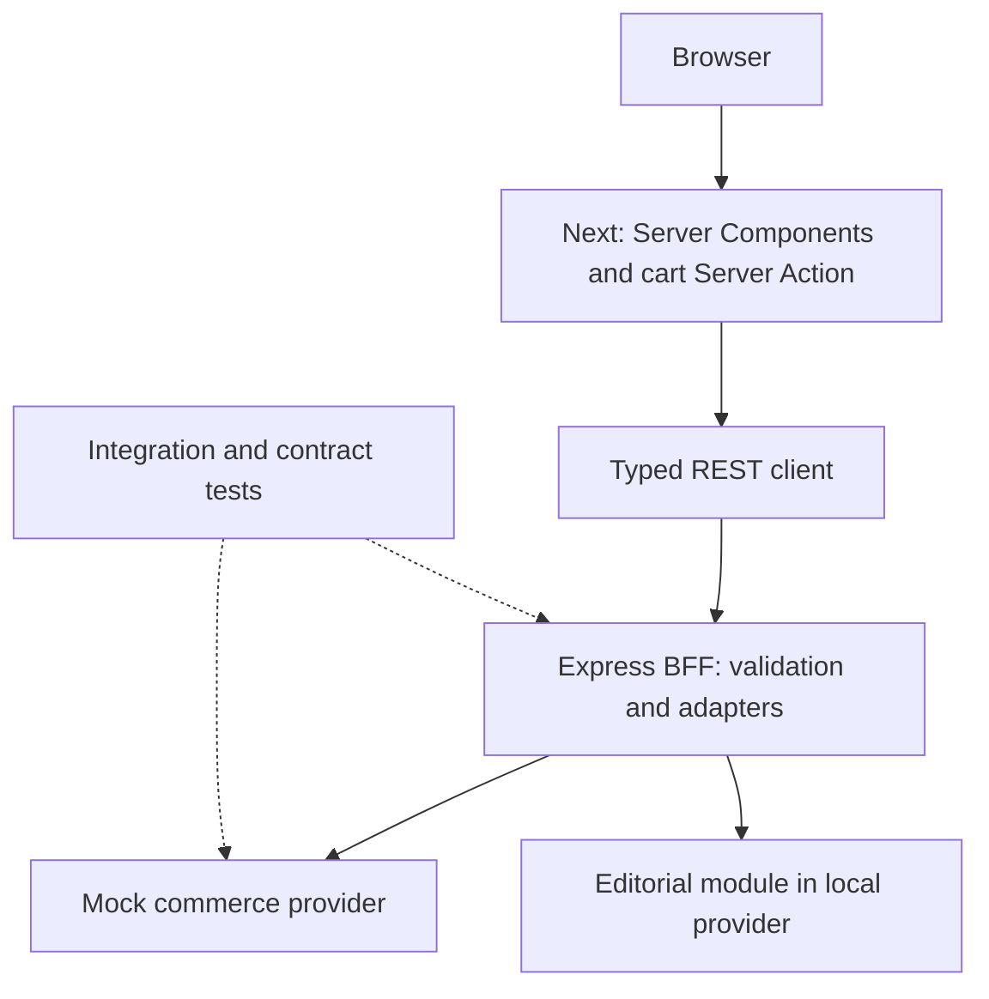

# Architecture

M2 implements product detail, catalog and editorial reads through typed REST clients and Express BFF. M3 slices 1–3 add a guest cart owned by commerce (add, view, change quantity, remove) and simulated order acceptance with idempotency.

| Boundary | Owns | Excludes |
| --- | --- | --- |
| apps/storefront | Rendering, accessibility, URL state, server-only API configuration | Authoritative prices/stock or provider secrets |
| apps/middleware | Express routes, provider clients, normalization, timeout/status/error mapping | UI or duplicate inventory/order storage |
| apps/mock-services | Vendor-shaped fixtures; future pricing/stock/order acceptance | Next-specific UI logic |
| packages/contracts | Domain DTOs/guards, typed HTTP client, OpenAPI | React/Express imports and runtime application state |

## Implemented product request

Next calls getCommerce().getProduct({id}). The shared client sends GET /api/products/:id to Express and validates JSON plus status. The BFF validates the identifier and rejects unexpected query parameters, calls the configured provider, validates its shape and returns normalized data. Provider-specific fields never reach the page.

M2 adds GET /api/products with validated collection/sort parameters, one provider list call and a complete normalized products/total result. The provider filters/sorts and shares fixtures with detail; malformed items, count disagreement or duplicate IDs invalidate the whole result. GET /api/content/brand exposes a separate editorial contract. Next reads catalog/content concurrently; editorial failure falls back locally, while commerce failures retain error/retry UI.

Catalog URL state is canonical and shared across native GET and enhanced navigation. A small Client Component controls filter transitions and focus; it does not duplicate filters in React state. Loading feedback is local to the transition. A shared route loading boundary is intentionally absent to preserve no-JavaScript HTML and real detail 404s. See [M2 decision](adr/0004-catalog-url-and-content.md).

The public ProductResult is either {ok:true,product} or {ok:false,error:{code,message,requestId}}. Errors use HTTP 400 INVALID_INPUT, 404 PRODUCT_NOT_FOUND, 502 UPSTREAM_UNAVAILABLE/UPSTREAM_INVALID_RESPONSE, 504 UPSTREAM_TIMEOUT, or 500 INTERNAL_ERROR. The public OpenAPI contract is bff-openapi.json; openapi.json describes the separate vendor provider.

Every BFF response includes no-store and X-Request-ID, generated by the server and propagated upstream. The provider timeout defaults to 1500 ms; the client's timeout defaults to 2500 ms and starts per request. Override both coherently. No automatic retries. Raw upstream bodies and exception stacks are not exposed. Server Components map missing products to Next's 404 and infrastructure failures to retry UI; malformed transport responses reach its error boundary.

## Implemented guest cart

The product page renders an Add to bag form bound to a Server Action. Next rejects cross-origin action requests. The action reads the opaque `atelier_cart` HttpOnly cookie, calls `addCartItem` (or `createCart` first when there is no cart or commerce no longer knows it), then redirects to `/cart`. The BFF accepts exactly `{productId, quantity}` with a 1 KB JSON limit, maps it to the vendor line shape and normalizes the vendor cart. Commerce stores carts in memory, checks current stock without reserving it and calculates all totals; the BFF rejects inconsistent totals. `/cart` is server-rendered per request and is not share-cached. Line edits use `PUT /api/carts/:id/items/:productId` with `{quantity}` (0 removes): idempotent set semantics, stock checked only on increase, CART_LINE_NOT_FOUND 404 for missing lines. Errors add CART_NOT_FOUND 404, OUT_OF_STOCK 409 and CART_LIMIT_EXCEEDED 409. See [ADR 0005](adr/0005-guest-cart-session.md).

## Implemented order acceptance

The bag renders a Place order form with a hidden idempotency key. The `placeOrder` Server Action sends `{cartId}` and `Idempotency-Key` to `POST /api/orders`; the BFF reads the commerce cart, sends only product IDs and quantities to the provider's `POST /orders`, and normalizes the result (201 created, 200 replay). The provider runs idempotency lookup, re-pricing, the all-or-nothing stock check, decrement, order creation and the key record synchronously; inventory is per provider instance. On success the cart cookie is cleared and the guest is redirected to the server-rendered `/orders/[id]`. New errors: ORDER_NOT_FOUND 404, CART_EMPTY 409, IDEMPOTENCY_CONFLICT 409. See [ADR 0006](adr/0006-order-acceptance-idempotency.md).

## Trust and future writes

- Trusted server configuration supplies addresses; user input cannot choose proxy URLs. Next configuration is server-only. Services bind to loopback on ports 3000/4000/4100. No browser CORS allowance is needed.
- Money uses integer cents, EUR. Future order input contains only IDs and quantities; the provider recalculates prices and checks stock.
- Cart mutations use a same-origin Server Action and an opaque HttpOnly guest session; possession of the random commerce cart ID scopes ownership. Never share-cache private responses.
- Simulated orders share one synchronous critical section for stock check, decrement, creation and idempotency records (verified by concurrency and mutation tests). Production needs durable transactional storage. Fixture state resets on restart.
- Bound body sizes and item counts (cart: 1 KB, 20 per line, 10 lines); reject fractional quantities, duplicates and unexpected price fields. Do not retry writes without idempotency guarantees.

Use npm workspaces, feature-oriented modules and composition. No generic repository hierarchy, database, event bus or task runner until justified. Providers are fictional local processes. Structured timing/outcome telemetry, containers and deployment are later decisions.

See [scope](adr/0001-boundaries-and-scope.md), [Express decision](adr/0003-express-bff.md), [stack](STACK.md) and [quality](QUALITY.md).
