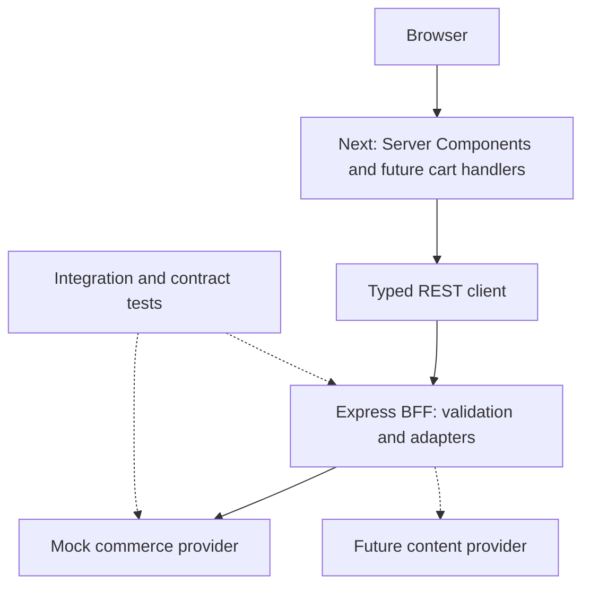

# Architecture

M1 implements product reads through a typed REST client and Express BFF. Catalog, content, cart and orders remain planned.

| Boundary | Owns | Excludes |
| --- | --- | --- |
| apps/storefront | Rendering, accessibility, URL state, server-only API configuration | Authoritative prices/stock or provider secrets |
| apps/middleware | Express routes, provider clients, normalization, timeout/status/error mapping | UI or duplicate inventory/order storage |
| apps/mock-services | Vendor-shaped fixtures; future pricing/stock/order acceptance | Next-specific UI logic |
| packages/contracts | Domain DTOs/guards, typed HTTP client, OpenAPI | React/Express imports and runtime application state |

## Implemented product request

Next calls getCommerce().getProduct({id}). The shared client sends GET /api/products/:id to Express and validates JSON plus status. The BFF validates the identifier and rejects unexpected query parameters, calls the configured provider, validates its shape and returns normalized data. Provider-specific fields never reach the page.

The public ProductResult is either {ok:true,product} or {ok:false,error:{code,message,requestId}}. Errors use HTTP 400 INVALID_INPUT, 404 PRODUCT_NOT_FOUND, 502 UPSTREAM_UNAVAILABLE/UPSTREAM_INVALID_RESPONSE, 504 UPSTREAM_TIMEOUT, or 500 INTERNAL_ERROR. The public OpenAPI contract is bff-openapi.json; openapi.json describes the separate vendor provider.

Every BFF response includes no-store and X-Request-ID, generated by the server and propagated upstream. The provider timeout defaults to 1500 ms; the client's timeout defaults to 2500 ms and starts per request. Override both coherently. No automatic retries. Raw upstream bodies and exception stacks are not exposed. Server Components map missing products to Next's 404 and infrastructure failures to retry UI; malformed transport responses reach its error boundary.

## Trust and future writes

- Trusted server configuration supplies addresses; user input cannot choose proxy URLs. Next configuration is server-only. Services bind to loopback on ports 3000/4000/4100. No browser CORS allowance is needed.
- Money uses integer cents, EUR. Future order input contains only IDs and quantities; the provider recalculates prices and checks stock.
- Future cart mutations use same-origin Next handlers, origin validation and an opaque HttpOnly guest session. Enforce ownership server-side and never share-cache private responses.
- For single-process simulated orders, stock check, decrement, creation and idempotency records must share one synchronous critical section. Production needs durable transactional storage. Planned fixture state resets on restart.
- Bound future body sizes and item counts; reject fractional quantities, duplicates and unexpected price fields. Do not retry writes without idempotency guarantees.

Use npm workspaces, feature-oriented modules and composition. No generic repository hierarchy, database, event bus or task runner until justified. Providers are fictional local processes. Structured timing/outcome telemetry, containers and deployment are later decisions.

See [scope](adr/0001-boundaries-and-scope.md), [Express decision](adr/0003-express-bff.md), [stack](STACK.md) and [quality](QUALITY.md).
